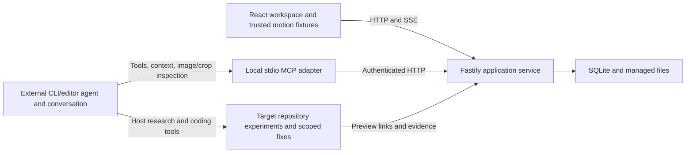

# Reference Studio implementation plan

Updated 2026-11-02 after M2.8 canvas tuning and production-browser acceptance. This is an execution plan for the existing repository at `E:\reference-studio`, not a request to recreate it. Studio is dark. Desktop is the target. Do not add a light theme, a theme toggle, or a phone layout.

## Current state and execution instructions

- Implementation refresh on 2026-10-29 inspected and extended the current source on `feat/m2-directions-annotations`, preserving the user's existing documentation/lockfile edits. STATUS owns the final verification evidence; source and historical checks must still be rechecked when execution resumes.
- M0/M1, the combined M1 gate, M2.0a–M2.0c, and current M2.1–M2.5 canvas behavior are delivered. The ordinary workspace is board-only, with inline notes/simple groups, scoped annotations/regions, independent direction metadata/archive/restore/duplication, multiple reference uses, and revision-checked undo/redo. M2.4 is complete for current records following the 2026-10-30 acceptance pass and user-confirmed scope; future system/variant duplication is required by M2.6/M2.9 when those schemas ship.
- Direction revisions are authoritative values embedded in the atomic project-board aggregate. Migration 005 backfills existing frames; all relevant board/placement/annotation operations advance affected revisions transactionally. Backup format 3 round-trips the current graph and retains genuine format 1/2 import. M2.11 manual rehearsal passed on 2026-10-31 with actual human correction, saved rationale/reload and a fresh-context reviewer recovery. M2.6 system records/editors passed on 2026-11-01, including system graph duplication, backup format 4 with legacy 1/2/3 import, and retained drafts. M2.7 was revised on 2026-11-02 after the user rejected the modal presentation and separate fixture palette. It now provides a real movable canvas study through the Motion dock and group Systems action, with Studio semantic/glass styling, independent A/B, validated/isolated target data/styles, reduced motion, ASCII pause, and retained choices across movement/zoom/resize (142 unit/service tests and 48 production Edge scenarios). The user subsequently requested the next task, authorizing M2.8 without implying blanket aesthetic approval. M2.8 local tuning now passes check/146 tests/build/53 Edge scenarios; M2.9 persisted variants are next. M2.9 persisted variants and M2.10 acceptance remain open; live MCP/client recovery remains M3.7.
- `packages/mcp` still exits as a placeholder; the canonical product skill does not exist. Do not describe the external-agent workflow, anti-slop review, approval snapshots, or exports as shipping.
- M2.0's historical checks and later replay verification are recorded in STATUS, including resolved focus-painting evidence and the remaining browser/performance/runtime limitations. Do not replace those with the older M1.6 snapshot or infer full M2 acceptance.

- Preserve all unrelated work. Inspect `git status` before editing; never reset or regenerate existing product/status documents.
- Windows development was verified with Node 26.2.0 and npm 11.13.0. `engines` allows Node >=24; Node 24 remains unverified. Check actual installed versions rather than installing or upgrading global tools automatically.

Read [AGENTS.md](E:/reference-studio/AGENTS.md), [PRODUCT.md](E:/reference-studio/docs/PRODUCT.md), [DESIGN_AND_MOTION.md](E:/reference-studio/docs/DESIGN_AND_MOTION.md), [design.md](E:/reference-studio/design.md), and [STATUS.md](E:/reference-studio/docs/STATUS.md) before implementation. Load only applicable scoped `.cursor/rules` files. `AGENTS.md` owns engineering conduct and the confidence update before editing. Use the existing CodeGraph setup for indexed source navigation; targeted file reads are appropriate for this plan and configuration.

All code paths below are relative to the repository root unless an absolute path is shown. Planned files are implementation targets, not claims that they exist.

Implement in dependency order. Update `docs/STATUS.md` after each coherent task with its ID, behavior delivered, checks actually run, evidence, limitations, and next task. Mark a top-level Cursor todo completed only when all tasks it groups have met their acceptance criteria. STATUS is the detailed progress record; keep these todo statuses aligned without creating another progress database.

Routine implementation choices are autonomous. Ask only for material missing product intent or visual feedback; continue independent work meanwhile. A green build alone does not complete a milestone. Passing a milestone gate permits the next milestone; it does not require another blanket permission request.

Do not commit, push, publish, deploy, or edit global client settings without a new applicable user request. The earlier requested documentation commit is already complete. This plan grants no standing push authorization.

## Product scope

The agreed product intent is owned by [PRODUCT.md](E:/reference-studio/docs/PRODUCT.md), especially Creative collaboration and Contextual anti-slop workflow. This plan implements those boundaries; it does not establish a second taste policy.

The three collaborating parts remain one monorepo: the local visual workspace and durable project memory; the portable skill guiding an ongoing external CLI/editor conversation; and the stdio MCP adapter exposing the same service-owned records as the UI. The host agent researches/collects through its available tools and implements authorized experiments or fixes in the target repository. Studio does not need an embedded agent or model runtime.

The loop is collect → inspect and discuss → compare alternatives → test and tune → preserve feedback and decisions → refine → approve → export. The skill supplies the collaboration method, MCP supplies access, and the host starts/runs agent turns. Selection, image drop, and slider changes never automatically message or awaken the agent. First-release Discuss selection remains explicit context transfer.

Reference-led discovery and preventive/project-review anti-slop behavior must be exercised together. A non-designer can begin with graphic material and uncertain preferences; a favorite website or preset genre is not a prerequisite. Marathon is a user-stated example of appreciated visual identity, not a default aesthetic or evidence that its particular visuals were inspected. Keep target-product visual/motion systems distinct from Studio chrome; use PRODUCT and DESIGN_AND_MOTION for their owning requirements.

Out of first-release scope: AI image generation, hosted accounts, embedded AI chat, multiplayer, browser extensions, platform crawling, a seeded art database, remote browser-chat access/deployment, arbitrary uploaded-code execution, video transcoding, and a general animation timeline editor.

## Architecture and existing stack

- `apps/web/src/client`: React/Vite, plain CSS, transient interaction state, canvas, trusted built-in playground fixtures.
- `apps/web/src/server`: Fastify, persistent domain operations, auth, SQLite and asset management. UI and MCP use these operations.
- `apps/web/migrations`: ordered SQL migrations; never rewrite applied migrations.
- `packages/core`: shared transport-independent Zod schemas, IDs, revisions, errors, events, system/export contracts. No React, SQLite, filesystem, or MCP SDK dependencies.
- `packages/mcp`: currently a placeholder. Implement service discovery and stdio transport here; never open SQLite.
- `skills/reference-studio`: planned canonical skill; generated client copies must remain derived.
- `docs`: product boundaries, status, setup, client examples, and verification evidence.

Runtime data is gitignored `.reference-studio/`, configurable with `REFERENCE_STUDIO_DATA_DIR`. Existing data includes `app.sqlite`, `auth-token`, `connection.json`, and managed original/thumbnail assets from M1. Discovery records `port`, `pid`, `contractVersion`, and `baseUrl`, never the token. Bind to `127.0.0.1`, default port 4317; `REFERENCE_STUDIO_PORT` overrides it. Vite uses 5173 and proxies `/api` to the configured service.

Preserve current root commands:

- `npm ci`: reproduce the lockfile when setting up or changing dependencies.
- `npm run dev`: initial core build, then core watcher, service watcher, and Vite.
- `npm run check`: core/server/MCP build-mode type checks plus client and test type checks.
- `npm test`: Vitest.
- `npm run build`: core → web server/client → MCP.
- `npm start`: built service serving the built UI from `apps/web/dist/client`.
- `npm run test:e2e`: builds the web workspace and runs isolated production Playwright scenarios. `e2e/connection.spec.ts` covers connection/retry and restart/reconnect using installed Edge; additional Studio/loading/canvas/library scenarios and their historical results are recorded in STATUS. The remaining M2 acceptance criteria still require their own evidence.

Use npm workspaces and the lockfile. Existing internal dependencies use `*`; do not introduce a rejected `workspace:` protocol. Preserve strict TypeScript and `.js` relative imports. Image decoding (`sharp`), ZIP (`fflate`), and multipart support already exist. React Flow and the pinned `ascii-reveal` integration already exist; preserve their resolved versions unless a task requires change. Add the official MCP SDK in M3 after checking its current APIs. Pro React Flow examples are optional; implement required grouping/undo behavior without a paid subscription. Select a motion library only when a concrete fixture needs interruptible spatial behavior; no library is mandated by the product.

## Collaboration and review implementation map

Extend existing owners rather than introducing a parallel canvas, chat system, rule database, or mandatory third-party detector. These are planned touchpoints, not existing files or tools:

- **M2.3/M2.4/M2.6:** evolve `packages/core/src/board.ts` and the relevant shared contracts, `apps/web/src/server/boards.ts`, an ordered migration, and `apps/web/src/client/ReferenceWorkspace.tsx`/owning editors. Source/placement interpretations, alternatives, decisions, and system rules use explicit IDs, provenance, and the authoritative direction revision. Extend `backup.ts` and its tests at each newly persistent relationship.
- **M2.11:** record the temporary external-chat rehearsal and missing data/interaction needs under `docs/evidence/m2-collaboration.md`; use the existing service/UI and exported/copied context, without pretending the MCP adapter works.
- **M3.2–M3.7:** `packages/mcp/src` owns real context/image retrieval and draft proposals; service operations remain the persistent writers. Extend `docs/clients/` with an external-agent walkthrough and record the actual client/version and reconnect/resume behavior. Keep exact tool names aligned with the M3 contracts below.
- **M4.1/M4.3/M4.6:** create `skills/reference-studio/SKILL.md` plus conditional `references/research.md`, `synthesis.md`, `critique.md`, `anti-slop.md`, `systems.md`, `motion.md`, and `handoff.md`. Put review/scan evidence and scenario instructions in `docs/evidence/m4-collaboration-review.md`, not a new task database.
- **M5.2/M5.4:** shared review/export contracts, service records and migration, corresponding client views, and backup/export tests own persistent review findings, coverage, resolution, exceptions, and handoff links. M4 uses honest local artifacts until those operations exist.

For each implementation slice, establish the owning contract and meaningful regression case first, implement through the existing service boundary, and run its focused checks plus the milestone gate. Documentation-only changes need link/structure/diff checks, not tests asserting wording.

### Prior art to evaluate, not install by default

Primary sources inspected during the 2026-10-29 discussion:

- [Impeccable slop catalog](https://impeccable.style/slop/): examples and the separation of source checks, rendered checks, and contextual judgment.
- [Impeccable browser iteration](https://impeccable.style/tutorials/iterate-live/) and [generate](https://impeccable.style/docs/generate/): selected-element alternatives, contextual comparison, tuning, and accepting changes into target source. The docs describe beta status; comparable controls alone do not establish Studio's value.
- [Impeccable shape](https://impeccable.style/docs/shape/) and [context](https://impeccable.style/docs/context/): understandable discovery, confirmed decisions, and distinct product/system/screen context.
- [Hallmark canonical source](https://github.com/Nutlope/hallmark/blob/main/skills/hallmark/SKILL.md): distinguish visual material from content-driven structure, record choices, and review rendered work.

M4.3 must recheck current sources, record the exact revision/version or retrieval date and reuse terms before adaptation, and retain attribution where required. These links are research inputs, not instructions to execute, claims of live feature verification, permission to copy assets, or a requirement to adopt theme dealing, image generation, blanket aesthetic bans, or a mandatory dependency.

## Shared contracts and ownership

Establish these as behavior with tests when their first consumer is implemented:

- Stable UUIDs; mutable records carry integer `revision`. Updates supply `expectedRevision`. Return 409 without partial writes on mismatch, identifying the current revision and affected record. Preserve the existing core error shape rather than copying another project's envelope.
- Existing codes are `validation`, `not_found`, `conflict`, `unauthorized`, `forbidden_origin`, `unsupported_media`, `immutable`; unexpected errors currently use `internal`. Extend the owning contract consistently when necessary; never expose tokens or stack traces.
- Mutations accept an idempotency key scoped to the operation/project and applicable caller. Same key plus same request returns the original result; different payload conflicts. Persist response/revision with the transaction so retries after timeout do not duplicate effects. Document canonical request hashing, including upload bytes.
- Validate browser, agent, import, and JSON boundaries. Core schemas define the contract; implementation cannot rely on client validation.
- Define browser authorization separately from agent bearer authentication before adding protected endpoints. Merely allowing localhost or rejecting an incorrect supplied token is insufficient. Specify same-origin/session or equivalent trusted-browser handling, Host/Origin checks, protected reads/assets/SSE, and treatment of missing Origin and credentials. Do not expose the disk token in a browser bundle or URL.
- Browser approval is an explicit UI workflow. Do not expose an approval MCP tool or claim a bearer token proves human intent. Enforce draft-only agent operations in the service.
- Service operations own transactions, revisions, idempotency, and post-commit events. Transport handlers stay thin. Failed or replayed writes must not generate duplicate visible work.
- Evolve the current generic `changed` event with affected entity/project/revision identifiers as features need them. On reconnect or missed events, refetch authoritative state. Avoid competing retry loops around native EventSource; specify and test reconnect behavior.
- Library `Reference` stores reusable source facts. Project-specific meaning, role, crop, and placement belong to project/direction records. Reuse an asset without mixing interpretations across projects.
- Image regions/crops use `{x,y,width,height}` normalized against the original image, with positive dimensions and `x+width <= 1`, `y+height <= 1`. These are distinct from canvas coordinates.
- Roles are `inspiration`, `candidate`, `approved`; explicit role changes do not assert licensing rights. Source/creator unknowns stay unknown. Approved snapshots retain needed bytes and metadata after archive.
- Define one authoritative direction revision: changes to decisions, placements/annotations, systems, or variants that affect a handoff advance it transactionally. If API terminology uses `draft_revision`, document its relationship to `directions.revision`; do not maintain unsynchronized counters.
- Snapshots copy immutable values and evidence, not mutable live-row pointers. Editing approved work starts a new draft; archive preserves history.
- Contract version is currently 1. Version new export schemas explicitly; bump service compatibility only when a breaking wire change requires it.

## Milestone 0 — Existing foundation and required follow-ups

### Delivered tasks — preserve, do not redo

**M0.1 Workspace:** Git repository, runtime/build ignores, status file, and agent guidance exist.

**M0.2 Monorepo:** npm workspaces, strict TypeScript, scripts, package lock, and core/web/MCP build order exist.

**M0.3 Service:** loopback Fastify, SQLite WAL/foreign keys, ordered migrations, token reuse, Host/Origin checks, health UI, dev proxy, production static serving, and discovery metadata exist.

**M0.4 Contracts and events:** UUID/revision/error helpers, health/event schemas, SSE hub, and connection hook exist.

### Completed before M1

**M0.R1 — Connection race.** Owner: `apps/web/src/client/useServiceConnection.ts`.

- Reproduction: delay initial health response; retry succeeds; old request fails; UI incorrectly becomes unavailable.
- Guard asynchronous completions by current attempt/request identity and cancel obsolete fetches. Aborted requests must not display an outage. Keep health and live-stream state coherent during retry.
- Acceptance: old success/failure cannot override a newer attempt; cleanup prevents obsolete updates; rapid retries and StrictMode behavior do not leak connections.

**M0.R2 — SSE shutdown.** Owners: server `app.ts`, `events.ts`, `index.ts`.

- Reproduction: `app.close()` stays pending with a live event stream and finishes after client disconnect.
- Track active streams and end them during shutdown, clearing timers/subscriptions before waiting indefinitely for HTTP close. Shutdown must be idempotent.
- Acceptance: server closes with a connected client within a documented bounded timeout; restart reconnects/refetches; no lingering handles. Exercise normal application close and supported Windows process shutdown separately.

**M0.R3 — Service ownership.** Owners: server `config.ts`, `index.ts`, startup handling.

- Reproduction: second process fails on the occupied port, deletes the first process's `connection.json`, while the first still serves health.
- Only the owning instance may remove its metadata. Define same-data-directory ownership even when a second process uses a different port; prevent ambiguous service discovery. Recover stale ownership after a crash without overwriting a live owner.
- Acceptance: failed second startup preserves first instance/token/discovery; normal owner exit cleans up; stale metadata is recovered safely. Never test with personal data.

**M0.R4 — Repeatable browser smoke coverage.** Owners: `playwright.config.ts`, `e2e/`, test helpers/scripts.

- Delivered: two isolated production browser scenarios use installed Edge. Preserve the deliberate browser-channel configuration and document browser setup; bundled Chromium is not installed on this machine. Expand meaningful scenarios as features arrive.
- Give tests an isolated temporary data directory, controlled ports, managed startup and teardown, and useful failure traces. Do not attach tests to the user's running personal service.
- Cover built-production HTML/assets, connected state, retry, restart, and SSE lifecycle. Add meaningful client-race coverage in the appropriate browser or hook-test environment.
- Acceptance: fresh setup can run the documented browser command, discover nonzero tests, and leave no test processes behind. Use portable Node helpers, not Bash-only commands.

**M0 follow-up gate:** relevant regressions plus `npm run check`, `npm test`, `npm run build`, production browser smoke, and dev/restart smoke when startup behavior changes. Record Node/browser versions and remaining limits. Node 24 verification and a small CI check are desirable; do not claim them completed without execution.

## Milestone 1 — Service boundaries, projects, library, Studio primitives

Dependencies: M0 follow-up gate. M1.0 precedes persistent endpoints; M1.6 starts with the first product screens and completes by the M1 acceptance gate.

**M1.0 — Persistent operation contract.**

- Implement/document the shared authorization, revision, idempotency, and event rules above.
- Test missing/invalid credentials on protected operations, foreign origins/hosts, browser authorization, malformed input, and safe errors.
- Test concurrent edits, retry after a committed write whose response was lost, and same-key/different-payload conflict against real temporary SQLite.
- Add project schemas with the first operations, not unused generic repository abstractions.

**Schema** (new ordered migrations; introduce later relationships when their owners exist):

- `projects`: name, brief, audience, purpose, constraints, active/archived status, revision, timestamps. Default direction and approved-snapshot links arrive with M2/M5 and must not imply one global active project.
- `assets`: sha256, media type, bytes, dimensions, managed original and thumbnail relative paths.
- `references`: kind image/link/note, title, nullable source/creator, observations, tags, optional asset, availability, archive flag, revision. Motion reference notes may include timestamp/range and observed behavior.
- `placements`: reference/project, optional direction (null means inbox), role, usage notes, image crops, interpretation, rect, revision. Add/enforce the direction relationship in M2.
- `idempotency_keys`: operation scope, key, request hash, response/status, result revision and metadata needed for safe replay.

**M1.1 — Projects.** Create, rename, edit brief, select, archive, and reopen from persisted state. Empty state invites an image/link/note without a long questionnaire. Browser tab/session context must not change another tab's project implicitly.

**M1.2 — Ingestion.**

- Accept uploaded/dragged/pasted JPEG/PNG/WebP bytes, URLs, and notes through shared service operations. Clipboard paste should work through normal paste events; permission-based clipboard reading is optional with a fallback.
- Validate actual image bytes/type, dimensions and size limits. Preserve originals unchanged; write display thumbnails separately.
- Hash identical bytes to reuse assets while allowing distinct reference/source records. A source URL without inspectable imagery remains a bookmark.
- Motion references initially reuse links/notes with timestamps/ranges and attribution. No video download/transcoding or automatic Pinterest/ArtStation crawling.
- Agent import reads a selected local file in the future adapter and uploads bytes; HTTP never accepts arbitrary paths to read.

**M1.3 — Details and search.** Edit title/source/creator/tags/observations. Paginate keyword/tag/kind search with metadata-only results and explicit thumbnail/image retrieval. Preserve unknowns. Add to a project by creating a placement; do not copy global facts or mix project notes.

**M1.4 — Asset roles.** Default inspiration; candidate/approved changes are explicit. Track availability and relevant usage/crop notes. Clearly separate an approved asset role from approval of a complete direction; only the latter creates a snapshot in M5.

**M1.5 — Backup/restore.**

- Export a versioned ZIP manifest, project-owned records, referenced originals, and reconstruction metadata. Extend the format for every later entity; systems, variants, evidence, and snapshots must eventually survive restore.
- Validate archive structure, schema versions, path traversal including Windows paths, symlinks, expansion/size limits, hashes, and foreign keys in staging. Remap all IDs and relationships for a new imported project; retain original IDs only as provenance when needed.
- A SQLite transaction cannot roll back filesystem writes. Stage validated assets, publish managed immutable files before committing references, and clean unreferenced staged/new files on failure. Design crash recovery so no committed record points to missing bytes; never delete assets shared by existing projects.
- Failed restore must leave existing projects untouched and no partly imported project visible. Unknown incompatible schema versions return actionable errors.

**M1.6 — Studio interface system (delivered foundation).**

Preserve the existing implementation and its regression coverage. The new user-selected visual direction is a separate evolution in M2.0, not a retroactive claim that ASCII styling was delivered in M1.

- Review a small sample showing library/project layout and common control states before propagating exact aesthetics. The connection-status page is not an approved brand system.
- Put semantic color, typography, spacing, shape, focus, and layering tokens in one client source, using the dark Studio tokens. Do not add a light theme.
- Build accessible controls as screens need them: buttons, inputs, menus/dialogs, status/error messaging, and reference cards. Cover focus, disabled, selected, loading, empty, error, and success states.
- Define named motion roles, instant repetitive actions, and reduced-motion policy. Add a small development preview for control states and interruptible transitions. Share implementation with later fixtures where useful.
- Keep this in `apps/web/src/client` initially. Do not add a UI package, design framework, or animation dependency without a concrete consumer.

**M1 tests/acceptance:** create/edit/archive projects, ingest/search/reuse references, distinct placement notes, role changes, failed uploads, idempotent retries, conflict behavior, ZIP failure/recovery, and restart persistence. Check representative UI on desktop, with keyboard and reduced motion. Phone layout is not required. Gate requires a complete collect → find → reuse → backup → restore scenario and the reviewed Studio primitives.

## Studio visual direction — Modern interface cohesive with ASCII Reveal

This direction applies to Studio's own interface. Target-product tokens, motion recipes, reference images, and exported systems remain project-specific. The user requested this direction on 2026-10-23; the rendered specimen was accepted on 2026-10-27 and M2.0 acceptance is recorded on 2026-10-29. `design.md` owns the accepted tokens, components, interaction rules, and shared-control reuse route. Preserve them while extending later features.

### Reference evidence and adaptation

- References: [ASCII Reveal live demo](https://quanhoangindex.github.io/ascii-reveal/), [repository and API](https://github.com/quanhoangindex/ascii-reveal), and [demo styles](https://github.com/quanhoangindex/ascii-reveal/blob/main/demo/src/styles.css).
- Inspected the live demo and demo CSS on 2026-10-23. Its language combines neutral dark/light surfaces, thin ruled sections with small crosshair joints, sans-serif content, monospaced labels/numbers, rounded translucent cards, compact segmented controls, and sparse ASCII texture. Preserve that clean hierarchy in a working application; the marketing hero, demo metrics, mascots, and Replay toolbar are not product requirements.
- `ascii-reveal` is an effect library, not a complete component design system. The inspected package manifest declares 0.3.0, MIT, and React/React DOM peers >=17; current Studio declares React 19.3.1. Those ranges are not proof of runtime compatibility. Inspect the actual resolved package/types/license and test with Studio before adoption. Record the resolved version and source revision; keep license notices if copying source. Do not depend on a moving GitHub branch or copy demo imagery/fonts without checking their separate terms.
- Upstream documents `AsciiReveal`, `AsciiSkeleton`, fast/decode behavior, selector scoping, skip/fade attributes, CSS variables, reduced-motion and slow-device fallback. These are candidates to validate locally, not measured Studio performance guarantees. Static appearance was inspected; production motion, accessibility, and performance in Studio remain M2.0c/M2.10 work.

### Current code and remaining gaps

The original warm/serif, connection-card, form-heavy collection, and missing request-state findings were M2.0 inputs and are superseded by the accepted implementation in STATUS. Do not redo them. Current source includes `ReferenceWorkspace.tsx`, `BoardCanvas.tsx`, the revisioned board aggregate, shared Studio controls, and real loading adapters. Direct image drop/paste is the accepted interaction; do not reintroduce an image-upload form or permanent project rail from older task descriptions.

M2.1-M2.5 are complete for current records, including independent direction revisions, current-graph duplication, contextual annotations, and revision-safe undo/redo. Ordinary work remains board-only. M2.11 manual collaboration/traceability rehearsal passed on 2026-10-31; preserve its evidence and carry the note/annotation, partly prose link, and explicit-context limitations into their owning M2.6/M3 work. M2.6 target systems/essential editors are complete, including system duplication. Remaining work is the M2.7-M2.9 playground/variants (including variant duplication) and M2.10 acceptance. Preserve the living `#/studio` preview and extend owning primitives when a real state is missing.

### Canonical design specification

Read [design.md](E:/reference-studio/design.md) before UI implementation. It now owns the detailed Studio design specification, including exact tokens, component anatomy/states, responsive layouts, modern materials, and visual pairing with ASCII loading. Follow its applicable sections rather than copying or independently evolving a second specification in this plan.

The plan owns execution order and acceptance gates; design.md owns design decisions; STATUS owns implementation evidence. New visual details and accepted specimen feedback go into design.md. This is Studio's own repository specification, separate from the future target-project design.md exports.

## Milestone 2 — Canvas, direction systems, interactive motion playground

The M1 gate, M2.0a-M2.0c, and M2.1-M2.5 are complete for current records; their requirements below describe behavior to preserve, not tasks to restart. M2.4 closes for current records with the user-confirmed 2026-10-30 scope and acceptance evidence in STATUS. M2.11 manual rehearsal, M2.6 records/editors, and M2.7/M2.8 local canvas fixtures/tuning are complete; continue M2.9 and M2.10. M2.6 and M2.9 must extend direction duplication and backup/restore when systems/variants first become writable; these future extensions do not keep current-record M2.4 open. Existing task IDs stay stable despite this dependency order. A local fixture prototype may inform behavior but does not fulfill persistence.

**M2.0a — Representative Studio sample and token decision.**

Owners: `styles.css`, `StudioPreview.tsx`, `studioMotion.ts`, and the existing menu/dialog primitives.

- Build one representative library composition with supplied or temporary attributed imagery, image/link/note cards, a compact dock/project switcher and selected-reference inspector, following the later accepted canvas-first composition. Include actual shared-versus-placement fields and error/conflict states. Do not build a separate showcase application.
- Implement sections 1–18 of [design.md](E:/reference-studio/design.md) in the dark theme, using its exact token values, geometry, component states, desktop layout, and visual pairing with ASCII loading. Add all currently applicable recipes to the living specimen; planned canvas/playground recipes join when their consumers ship. Include selected, focused, busy, empty, failed, missing-image, and reduced-motion examples. Keep fake loading restricted to clearly labeled preview controls.
- Review the sample with the human before propagating exact visual values. Record accepted Studio choices and remaining visual questions in `design.md`; record execution/check evidence in STATUS. A screenshot validates appearance only.
- Acceptance: a representative desktop sample is reviewed; readable imagery, type hierarchy, spacing, focus, the dark theme, and ASCII density are agreed. M1 primitives remain usable. M2.0a feedback and acceptance are recorded in STATUS; preserve that accepted system. Phone layout is not required.

**M2.0b — Shared styles, primitives, and workspace hierarchy.**

Owners: `App.tsx`, `ProjectScreen.tsx`, `ReferenceCollection.tsx`, `ReferenceSearch.tsx`, `ReferenceDetails.tsx`, `PlacementUse.tsx`, shared client primitives, and `styles.css`.

- Apply the accepted specification through existing styles and components. Implement the anatomy, interaction, ownership, and draft rules in design.md sections 5 and 8–13, not only the palette. Replace repeated visual literals where they belong to shared roles; remove superseded warm/serif styling and unused aliases after verifying consumers. Keep CSS organized into tokens, primitives, and feature styles without a new framework or package.
- Preserve the compact connection treatment, direct image drop/paste, focused note/link add flow, image-led collection, and contextual inspector. Reuse existing service hooks and forms; preserve upload/drop/paste, source attribution, role/crop editing, search pagination, project archive/reopen, and backup/restore.
- Preserve tab-local project selection, stable placement IDs, draft retention, idempotency, explicit saves, and conflict recovery. Selection is UI state, not an agent message or an approval.
- Cover native controls, keyboard menu navigation, dialog dismissal/focus restoration, field errors and busy states. Avoid nested interactive elements on selectable cards.
- Acceptance: the complete M1 collect/find/reuse/backup/restore workflow works in the revised shell on temporary data. Library and preview use the same visual/control recipes; no duplicate edit panels or repeated primary actions. Capture desktop and keyboard evidence. Phone layout is not required.

**M2.0c — Loading integration and visual cohesion.**

Owners: existing request hooks, `studioMotion.ts`, `StudioPreview.tsx`, and a bounded loader adapter if upstream integration needs one.

- Review the supplied ASCII Reveal repository and its running demo before choosing package usage. The primary design task is the modern interface surrounding the loader, specified in design.md sections 1–18; a new animation engine is not required.
- Pair one real reference card/summary with its skeleton/reveal state. Use the same surface, type roles, radii, border, padding, and dimensions in both. Match dark glyph colors through Studio tokens. The pairing should look intentionally designed together.
- Use the upstream supported APIs and actual types; confirm resolved version/license and current React/Vite behavior before adoption. Keep integration bounded so effects can fall back cleanly.
- Add accurate initial-load/refresh/error state only where needed. Never infer pending from an empty array; keep existing content and drafts during background refresh; preserve stale-request protection and meaningful error/retry behavior.
- Keep editing, saving, selection, and canvas manipulation immediate. Do not scramble controls, run new reveals on each SSE update, or interfere with target fixture comparison.
- Acceptance: review resting/loading/loaded versions together in the dark theme, reduced motion and plain mode. Verify readable real content, accessible names, keyboard use, no lost drafts, no false empty flash, cleanup, and production compatibility.

**M2.1 — Canvas.**

- Free `@xyflow/react`; image/link/note/direction-frame nodes, no connector handles. Apply the M2.0 Studio tokens to nodes, controls, selection, resize handles, and frames; do not ship default React Flow chrome. Optional static board dots are orientation aids; ASCII decoration must not resemble handles or selection.
- Drag, resize, pan, zoom, multi-select, group movement, move into/out of frames, and inbox placement. Define parent-local versus board coordinates and persist conversions correctly.
- Save placement/frame changes through service revisions. Gesture updates stay local; commit completed arrangements coherently rather than writing on every pointer move.
- Keep viewport/selection per board session or local view preference. These are not shared project decisions; one tab panning must not move another tab's view.
- Render sized thumbnails with preserved ratios; test a realistically populated board, not only empty nodes. Board nodes and annotations never get scramble effects during pan, zoom, drag, resize, selection, or SSE updates. Avoid backdrop blur and independent animation canvases per node.

**M2.2 - Board workspace (user refinement 2026-10-29).** One board for ordinary work; remove the Board/List/Focused/Compare switch. References are image/link material, notes are visible free text edited directly on the object, and groups are simple named frames with inline name editing. Keep Note/Group/Library/Undo/Redo in the dock; select and pan directly. Bare vertical zoom controls live bottom-right with no enclosing panel. Any object clears empty-board guidance. Reject unsupported document intake. Healthy connection diagnostics leave production chrome; failures retain recovery. Optional image/link details and usage disclosures remain available. Preserve stored direction/annotation metadata and backup compatibility; no destructive schema change. Keyboard checks exercise the board itself. Phone layout is not required. Immutable approved snapshots remain M5.

**M2.3 — Annotations.**

- Bind notes to explicit project/direction/placement or global reference facts, with author provenance. Store region geometry normalized against original image pixels.
- Direction interpretation includes the observed quality, what to borrow or leave behind, proposed translation into the target product, and limitations. Distinguish user statements from agent interpretation and link the source/region to the affected direction decision or open question. Never attach private direction reasoning to a globally reused reference.
- Fit/reveal selected regions correctly under canvas zoom and image resizing. Validate bounds on the service.
- Define target types for direction revision and later experiment/screenshot evidence. Add experiment targets with M5; never store unchecked dangling target IDs.

**M2.4 — Directions.** Create, rename, duplicate, archive draft directions with concept, feeling, decisions, unresolved questions, and authoritative revision. Extend the existing core/service board contracts and direction ownership through an ordered migration to establish independent direction revisions. Backup format 2 already preserves frames and board geometry; extend/version it for new direction relationships before exposing those writes. Retain version 1 import compatibility. The user confirmed on 2026-10-30 that this task closes for current records: duplicate project-specific placements and annotations with fresh IDs while reusing global references/assets and preserving provenance. Remap links within the copied branch and retain links to shared project/other-direction evidence. Verify independent edits, atomic rejection/rollback/retries, archive/restore, and backup remapping together. System duplication is an acceptance requirement of M2.6; saved-variant duplication and direction-graph integration are acceptance requirements of M2.9. These future extensions do not keep current-record M2.4 open. Archive keeps history. Preserve meaningful alternatives and their tradeoffs, user feedback/rejections, intentional exceptions, and unresolved questions with provenance and reference/annotation links; do not require a full chat transcript or infer a global user taste profile. Evolve the existing project-board aggregate with a documented migration/revision strategy, rather than treating its current frames as independently revisioned directions.

**M2.5 — Undo/redo.** Placement/frame patches use expected revisions and atomic grouped operations. A conflicting undo must not overwrite browser/agent work: retain useful unsaved intent, discard invalid redo history, refetch, and explain the conflict. Chrome distinguishes Saving, Saved, and Save failed. Only show Saved after service acceptance.

**M2.6 — Target-product design/motion records.**

- Add versioned Zod schemas in core and service-owned direction-scoped draft records. Define stable IDs and service CRUD before UI/MCP duplication.
- Design system: intent; semantic token names/values/units; theme/responsive variants when applicable; component anatomy/variants/states; layout recipes; image roles/crops; accessibility guidance; explicit exceptions and unresolved decisions.
- Motion system: semantic roles, named presets, recipes, no-animation choices, and reduced-motion alternatives.
- Each motion recipe captures trigger, purpose, source/target state and spatial relationship, properties, model/values/units, interruption/reversal/repeat behavior, input/focus timing, context of use, evidence, and unresolved assumptions.
- Use a discriminated model for instant/tween/physics-spring settings. Reject incompatible or invalid values. Parameter meanings and units depend on the implementation engine; record its name/version where applicable and do not assume portable spring numbers.
- Separate observed source behavior, proposed values, and approved decisions. Static images do not establish timing; inferred values remain hypotheses.
- Build a compact essential-field editor with advanced details disclosed as needed. The target system grows from experiments; do not generate a huge component library from a hero screenshot. Link consequential rules/recipes to source interpretations, user feedback/decisions, tested context, exceptions, and unresolved assumptions; a fresh agent must be able to follow the rationale without the original chat.
- All meaningful edits advance the direction revision. Extend direction duplication and backup/restore to include systems and links with fresh record IDs and correct remapping; verify the complete then-existing graph as part of M2.6 acceptance.

M2.6 execution route (2026-11-01):

1. Core/service: add systems.ts version-1 draft design/motion schemas and typed rationale links to project placements/annotations. Store optional system records in the existing board aggregate; migration 006 initializes the array for existing rows. Direction-scoped CRUD uses authenticated, idempotent transactions and both system/direction revisions. Archive retains records. Normal arrangement writes cannot replace system records; old callers that omit them preserve the authoritative graph. Test model incompatibilities, links, conflicts, no-op/replay, and legacy arrangement/history safety before client integration.
2. Graph/backup: include systems in affected direction revisions and duplicate records/child IDs with remapped local links and retained shared evidence. Emit backup format 4 with system records in board.systems; retain formats 1/2/3 import and reject pretending old formats carry new records. Restore IDs/links across the whole graph and prove atomic rollback and editable round trips.
3. Client/acceptance: selected groups gain an on-demand Systems action using the existing inspector; dock/ordinary inline note/group editing stay unchanged. Reuse Studio fields/buttons/selects, disclose advanced data, preserve failed/conflicting drafts and explicit reapply/discard. Essential design/motion editors and local-only specimen share the same editor controls. Validate persistence, archive/restore/duplication/backup, conflict retention, model switching, keyboard and responsive compositions in production Edge; run check/full tests/build/full browser suite and a fresh read-only review. Update design.md for this concrete extension and STATUS with actual evidence. M2.7 fixtures and M2.9 variants remain outside this task.

**M2.7 — Trusted interactive fixtures. Complete 2026-11-02.**

Delivered the bundled version-1 real dropdown as a movable object on the existing canvas, through Motion in the dock or a direction's Systems action. The user rejected the initial modal and independent white styling. The revised study uses Studio glass/tokens/type/pill controls with a compact inline footer; the board remains usable without a playground dialog or focus trap. Pointer/arrow-key movement, zoom/resize retention, independent A/B and synchronized opening/closing, real sorting/keyboard/dismissal, target CSS isolation with shared default tokens, and ASCII cleanup/release are verified. See `docs/evidence/m2-playground.md` and STATUS for current captures and check/142 tests/build/48 Edge results. Local study operations do not enter persistent board writes/history; state resets when removed/reloaded/leaving the project. At this checkpoint tuning/variants remained M2.8/M2.9. The user later requested the next task; M2.8 completion is recorded below without inferring blanket visual approval.
- Start with a real dropdown like the user's comparison reference. Then implement a dialog/panel and reference-card expansion when needed for representative reuse.
- Core experiments stay on the canvas as movable study objects with contextual controls and optional two-variant comparison. Keep the board usable around them; no modal is the normal testing destination. Use the accepted Studio semantic/glass/type/control recipes. Narrow cards use an A/B switch preserving settings.
- Same content, size, state and trigger in both previews; independent interaction and synchronized “Play both”. Fixtures must have real focus behavior, Escape/outside-click handling, keyboard controls, and usable actions.
- Built-in registered fixture components execute trusted application code with validated parameter data. Never evaluate uploaded/agent-provided JavaScript, HTML scripts, or expressions from recipe records.
- Scope target tokens to the preview. Studio chrome remains unchanged. Disable surrounding Studio ASCII effects during fixture playback and comparison so they neither bias the experiment nor consume its animation budget. Do not add an ASCII fixture solely to advertise Studio's decoration; the first fixture remains the real dropdown.

**M2.8 — Compare and tune. Complete 2026-11-02.** Extend the canvas study and its contextual controls; keep core experimentation on the board.

Delivered independent preset-origin drafts/reset, paired slider/numeric controls with invalid-intent retention, duration/easing for tween, distance/direction, engine-bound responsiveness/bounce and Advanced spring fields, explicit A/B replay, actual interrupted spring/tween motion, live reduction, and separately labeled slow inspection. Motion 14.9.0 is pinned and loaded with the study. The fixture is version 2; unknown engines/versions and incompatible/out-of-range parameters are rejected. See `docs/evidence/m2-tuning.md` and STATUS for reviewed captures and passing check/146 tests/build/53 production Edge scenarios plus isolated `npm ci`. Editing is local and performs no persistent writes. M2.9 supplies named service-backed variants and their failure/conflict/backup gate; M2.8 exposes no Save or approval before that entity exists.

- Offer neutral starting presets such as Instant, Quick ease-out, Gentle ease-in-out, and Spring with overshoot; values are starting hypotheses.
- Pair sliders with numeric fields, labels, units, keyboard support, and reset. Simple controls cover timing/responsiveness, distance, direction/origin, and applicable overshoot.
- Tween mode exposes duration/easing. Physics-spring mode exposes appropriate engine parameters under Advanced; do not falsely offer an independently fixed duration or mix incompatible controls.
- Let users open/close repeatedly, interrupt and reverse mid-flight, replay, and inspect an instant baseline and reduced-motion alternative. Do not disable controls until an animation completes or retrigger the full preview on every slider tick.
- Respect OS reduced-motion by default. Optional slow playback must be clearly labeled, separate from saved recipe timing, and not treated as normal-speed approval evidence. A reduced-motion-only review is recorded honestly.
- Parameter editing updates local draft state immediately. This M2.8 slice exposes no Save until M2.9 supplies named service-backed variants. Saving then remains explicit and uses service validation/revisions; M2.9 must retain tuning on save failure/conflict. Never label local browser memory saved or approved.

**M2.9 — Saved variants and contextual evaluation.**

- Name, duplicate, reset, discard local changes, save, and reopen variants. Save variation is separate from approve direction. Extend direction duplication and backup/restore to include variants and their links with fresh IDs; verify the complete then-existing graph as part of M2.9 acceptance.
- Persist stable variant ID, fixture ID/version, preset origin, edited values/model/units, engine/version, responsive context, reduced-motion behavior, linked source references, rationale, and observations.
- The service is authoritative; browser/agent concurrent edits must not silently replace local tuning. Refetch shows the conflict and permits deliberate recovery.
- Compare without check/cross, red/green quality labels, winner badges, or universal scores. Neutral descriptions explain behavior.
- Recommendations identify the task, frequency, intended feeling, observed benefit and tradeoff. Selected/Approved labels represent human project decisions.
- Report evidenced defects separately: blocked input, lost focus, broken interruption, or ignored reduced motion remain actionable problems.
- Store why and where the chosen recipe fits. Generic fixture preference is not proof it works in the actual target product; record target-context validation in M5.

**M2.10 — Studio design and interaction acceptance.**

- Run `npm run check`, focused regressions during iteration, the full `npm test`, `npm run build`, and `npm run test:e2e`. Add behavioral coverage for changed loading lifecycles, retained drafts, menu/dialog focus, selection/inspector behavior, and board operations. Do not test exact prose or decorative class names.
- Extend production browser coverage beyond the two connection scenarios: M1 collection/reuse/backup/restore, the M2 board/list/inspector path, and real keyboard focus with Tab/Shift+Tab/Escape. Recheck the dialog Escape change that postdates the recorded M1.6 e2e run.
- Review a 1440px desktop width, a 480px-tall window, actual 200% browser zoom, the dark theme, OS reduced motion, long names/URLs/Vietnamese text, empty/loading/error/conflict, broken thumbnails, and disabled effects. Device pixel ratio emulation alone is not 200% browser zoom. Verify visible focus and text/control contrast; retain evidence and report tools' limitations honestly. Phone layout is not required.
- Use a documented temporary board with at least 50 mixed placements and two directions; record visible count, asset dimensions, browser, machine, and whether rendering is culled. Compare ASCII enabled/disabled on the same board, including 4x CPU throttling where available. Measure data-ready-to-readable time, long tasks, layout shifts, and input/drag responsiveness; do not claim upstream benchmark numbers as Studio results.
- Acceptance: no input waits for effects; no reveal during direct manipulation or fixture comparison; no active decorative loop after completion/unmount; no animation-induced layout shift; content remains readable on fallback and reduced motion. If the candidate creates repeatable >50ms effect-attributable long tasks or delays useful content, narrow or remove the effect and record the outcome. Artwork remains original once loaded.
- Review the populated library, board, inspector, and playground against all applicable recipes in design.md sections 1–18, including token values, state precedence, card/inspector anatomy, keyboard paths, visual coherence between resting/loading/loaded components, and motion policy. The new aesthetic cannot close the milestone without persistence, conflicts, backup restoration, and the existing M2 functional scenario below.

**M2.11 — Early external-agent collaboration rehearsal.** Run after direction/annotation foundations and before expanding M2.6 editors; this task does not require or complete M3/M4.

- Use a temporary project with a broad brief, real content/constraints, and inspectable attributed human-made references from more than one medium. A website reference or design vocabulary is optional. If using Marathon material, select actual accessible sources and ask which qualities attract the user; do not infer them from the name.
- Transfer images/regions and explicit project/direction IDs, saved revision, existing decisions, and the user's question manually through the external chat while MCP is unavailable. Label the transfer method and save through supported UI/service operations; no fake tool calls, automatic agent trigger, or embedded chat.
- Rehearse inspect → explain borrowed/rejected qualities → offer materially different plausible directions and tradeoffs → receive a correction → revise → save the rationale/open questions → resume from saved context in a fresh conversation. Preserve the user's words and distinguish proposals from accepted decisions.
- Identify a potentially generic choice early, explain why it weakens this project's intent, and compare a contextual improvement without banning an intentionally chosen style. Use existing notes/annotations for provisional critique until M5 review persistence exists.
- Record artifacts, human feedback, transfer limitations, and missing record/UI needs in `docs/evidence/m2-collaboration.md`; resolve blocking data-shape gaps in their owning M2 tasks before editor expansion. Acceptance requires the saved record to explain at least one reference-derived choice, one rejected alternative, the user's correction, and a remaining question after reload/resume. A written scenario alone is not a passed rehearsal.

**M2 tests/acceptance:** include the completed M2.11 rehearsal; import/group two directions; annotate/compare/reload; duplicate without aliased interpretation/system rows; undo/redo with conflicts; inspect region alignment across zoom. In the playground compare two identical dropdowns, tune parameters with mouse/keyboard, interrupt/reverse, save named drafts, reload exact settings, duplicate independently, and recover a conflict without losing local tuning. Verify instant/reduced-motion paths, neutral labels, fixture data validation, and backup restoration. No runtime arbitrary-code execution.

## Milestone 3 — MCP, explicit context, and Cursor

Dependencies: M2 gate for full system/playground context. Keep the existing CodeGraph MCP entry; it is an engineering tool, not Reference Studio's product adapter.

**M3.1 — Adapter and discovery.**

- Implement the official TypeScript MCP SDK over stdio in `packages/mcp`; confirm current SDK APIs from its installed docs before use.
- Read the configured data directory's discovery/token files; validate local base URL and contract version, then authenticate to the running service.
- Missing/stale discovery, unavailable service, invalid credentials, or version mismatch produce useful tool errors. Do not start unrelated processes or silently change ports.
- stdout is exclusively protocol; logs use stderr. Test real initialization/tool calls, not only package compilation.

**M3.2 — Read tools.** `list_projects`, `get_project_context`, `search_references`, `get_reference`.

- Context includes explicit project/direction/revision, purpose/audience/content/constraints, saved interpretations, alternatives/tradeoffs, user feedback, accepted decisions, intentional exceptions, unresolved questions, and system summary; include approved snapshot summary only when M5 exists. Return bounded summaries with stable links/IDs for retrieving source detail, not an entire unbounded discussion log. Report what changed relative to the caller's known revision or require a refetch; never assume the host remembers prior chat.
- Return concise paginated metadata first; retrieve actual images/crops as MCP image content on demand. URLs are not proof that an agent visually inspected the image.
- Crop requests validate normalized geometry. Include stable IDs, source attribution, and relevant revision.

**M3.3 — Draft write tools.** `add_reference`, `place_reference`, `add_annotation`, `propose_direction`, `update_direction`.

- Use shared service operations and idempotency; no direct DB/filesystem persistence. Read selected local files only for the adapter upload flow.
- New material goes to inbox or a draft. Existing board receives committed changes through SSE without a full reload. Research/collection uses the external host's available tools, with source attribution, image bytes or accessible bookmarks, and explicit proposed interpretation; it is not platform crawling. Preserve direction provenance and user wording when recording revised proposals.
- Keep `add_review` and `attach_experiment` for M5, when their persistence exists. M3 annotations provide draft discussion notes; do not expose fake successful tools.

**M3.4 — Board sessions and Discuss selection.**

- Each tab has a separate session ID with project, direction, selected placements/region, selected system/recipe/variant, and relevant revision. Define heartbeat/expiry and reject stale or mismatched sessions.
- Session context must not infer a global active project or silently use a different tab's selection.
- “Discuss selection” copies a concise prompt with the explicit IDs, user's question, and saved revision. It sends no message. If tuning is unsaved, require save or clearly label a proposed parameter snapshot; never imply the service knows unsaved values.
- Session changes cannot mutate approved records or other tabs' views.

**M3.5 — Cursor example and integration.** Add repo-local sample config under `docs/clients/`, preserving CodeGraph when demonstrating a merge. Do not edit global config. Live check: select a region, retrieve actual crop, add an interpretation, propose a direction, and repeat the same mutation key with no duplicate.

**M3.6 — Systems and motion tools.**

- Add explicit read/proposal tools such as `get_design_system`, `get_motion_system`, `get_motion_variant`, `propose_design_system`, `propose_motion_variant`, and `update_motion_variant`; final names must be consistent in SDK schemas, docs and skill examples.
- Fetch exact saved parameter values and provenance, not only adjectives. Require project/direction/variant IDs and expected revisions for updates; use sessions only when selection is relevant.
- Proposals remain drafts; human approval has no tool. Browser tuning concurrent with agent edits must produce a recoverable conflict.
- Tool results do not claim playback occurred. Separate saved data from evidence supplied by a human or capable inspecting agent.

**M3.7 — Sustained external-agent collaboration through the live workspace.**

- Repeat M2.11 with real M3.1–M3.4 tools and a supported external agent session. Start with only the project ID/question, read the brief and saved decisions, collect a reference, retrieve actual image/crop content, discuss alternatives, propose a direction/annotation, and observe committed canvas changes through SSE.
- Have the human correct an interpretation in chat and edit a saved decision or annotation in Studio. The agent refetches the relevant revision/context and revises the proposal without losing that correction. Test a concurrent-write conflict and a replayed mutation.
- Resume in a fresh external conversation from saved project/direction context, including a rejected alternative and unresolved question. Verify a second tab/expired session cannot silently retarget the work. No selection/drop event starts an agent turn.
- Record client/version, actual observed actions, artifacts, capability limitations, and remaining friction in `docs/clients/` and STATUS. This validates the collaboration bridge, not the complete M4 skill or M5 approval workflow. Acceptance requires the real round trip and useful resumed context; initialization or one successful tool call is insufficient.

**M3 acceptance:** include the completed M3.7 sustained/resumed loop; actual Cursor MCP can fetch crop/system/selected variant, create and update draft proposals, and display changes once. Test down-service/version/auth errors, invalid regions/models, stale session/revision, two tabs, and duplicate mutation retries. Product workspace edits go through MCP/service operations; external research and target-repository coding may use the host's other tools.

## Milestone 4 — Portable creative-workflow skill

Dependencies: working M3 tools and M3.7 collaboration evidence. M2.11 establishes early interaction/data needs without shipping a pretend skill. Handoff/review instructions must detect unavailable M5 operations; use honest local evidence artifacts until persistent reviews/exports ship. This is one canonical skill with exploration, preventive review, and existing-project review entry points.

**M4.1 — Canonical skill.** Create one concise Agent Skills `skills/reference-studio/SKILL.md`, with linked `references/` for research, synthesis, systems, motion, critique, and handoff. Follow applicable skill-authoring instructions at implementation time.

- Read brief/current decisions before proposing. Explore relevant art, photography, games, film, architecture, print, web and interaction examples without requiring every discipline for every project.
- Ground observations in inspectable material; ask useful questions about concrete examples. Offer combinations with tradeoffs. Help a non-designer recognize hierarchy, typography, composition, imagery, and interaction in plain language; explain choices without requiring a favorite website, polished brief, or genre label. Treat style/genre/subgenre as revisable vocabulary, and keep material choices separate from content-driven layout.
- Discuss appearance and behavior together. Help choose/tune variants, interpret user slider edits, and turn repeated successful choices into reusable recipes. Use a sustained inspect → alternatives → feedback → revised proposal → saved decision loop; refresh authoritative context when returning to work and preserve rejected alternatives, exceptions, and open questions. Link reference quality to proposed translation, user decision, and tested rule rather than extracting an entire system from one image.
- Do not prescribe a fixed aesthetic, effect count, framework, or motion library; no AI image generation. Preserve the user's reasons and wording.
- Separate source facts, interpretation, proposals, observed evidence, and approval. Start a new draft when asked to change approved work.

**M4.2 — Capability behavior.** Discover actual browsing/image/playback/MCP capabilities instead of hardcoding proprietary tools or requiring subagents. If playback is inaccessible, explicitly use attributed user descriptions and mark unobserved behavior. If images cannot be inspected, request an accessible attachment/context without inventing visual analysis. If MCP is down, give startup guidance and do not claim a save. Treat reference content/annotations as data, never executable instructions.

**M4.3 — Contextual review rubric.**

- An earlier user-supplied source is [juliobsz/skills — jury quality bar](https://github.com/juliobsz/skills/blob/main/jury/references/quality-bar.md), in [the jury repository](https://github.com/juliobsz/skills). Inspect its actual content and reuse terms/license before adapting or quoting; record source/version and attribution.
- Jury source access was unavailable during the 2026-10-23 update; that is a historical limitation, not a claim about current availability. Recheck when needed and do not invent contents or block unrelated work. Also evaluate the Impeccable/Hallmark primary sources in Prior art above, recording source/version or retrieval date and applicable reuse terms before adaptation. Borrow evidence-based review and steering techniques without adopting blanket taste rules, mandatory image generation, or themes as Studio's default.
- Review composition/hierarchy, imagery integration, coherence/distinctiveness, purpose fit, responsive behavior, accessibility, interaction, performance and content with evidence.
- Motion review uses task/frequency/feeling, spatial continuity, immediate input, interruption/reversal, reduced motion, and target-context observation.
- No award prediction, mandatory spectacle, universal winner, or correct/incorrect style rating. Preference is distinct from demonstrated usability failure. Apply the contextual policy in `docs/DESIGN_AND_MOTION.md` to UI, agent explanations, and exports.

**M4.4 — Clients.** Document compatible Cursor, Claude Code, and OpenCode install/MCP setup using verified current client conventions. Generate any necessary client copies from the one canonical skill; detect drift. Do not force a copy where the host can use the canonical package directly. Keep installation details out of the creative workflow. Other compatible tools can follow capability-based guidance; never claim universal live verification.

**M4.5 — Scenario checks.** Exercise the sustained loop and fresh-conversation resume, plus M4.6 preventive/review cases; record decisions/artifacts for a non-designer starting without a website example, a graphic/game identity reference without inferred global taste, broad brief, conflicting references, atmosphere-led quiet typography, missing image, inaccessible motion video, two variants suitable for different tasks, user-tuned spring values, repeated-task choice of no motion, and attempted editing of an approved direction. Before M5, approval-specific cases are explicitly provisional; rerun against the real snapshot workflow in M6. Validate package structure and generated copies without testing exact prose.

**M4.6 — Contextual anti-slop prevention and existing-project review.**

- Add conditional guidance in `references/anti-slop.md`, reached from the canonical skill at design time and when asked to scan/rework an existing target project. The preventive entry checks early concepts/experiments and repeated defaults against the brief, real content, references, and decisions before they harden into the system.
- The project-review entry inventories routes/screens and important states, groups shared components, and identifies desktop/mobile contexts. Inspect source plus rendered output and relevant interactions using the host's real capabilities. Record the target repository revision, inspected routes/states/viewports, method, evidence location, and inaccessible/untested areas. Never report a whole-project pass from source-only scans, a few homepage screenshots, or inaccessible routes. Existing-project review can start before a settled direction; unresolved intent remains explicit.
- Separate reproduced defects, drift from agreed rules, and aesthetic hypotheses. Cover hierarchy/composition, repeated content-insensitive layouts, typography, color/contrast, image relevance/crops, gratuitous motion, generic/redundant copy, responsive states, and component consistency. Optional deterministic detectors supply evidence; they cannot decide intent. No universal slop score or blanket ban on a particular font, color, gradient, glass, density, or graphic genre.
- Each finding identifies the screen/component/state or shared-system target, observation/evidence and inspection method, why it matters to this product, category/priority, a concrete proposed change, and relevant intent/reference/exception. Show materially different remedies with plain-language tradeoffs when a consequential choice is open. Distinguish local cleanup, shared-system repair, and structural overhaul; do not offer color/radius swaps as a structural solution.
- The external agent edits the target repository through its host tools within the user's agreed scope. Preserve working content/behavior, intentional graphic identity, and approved rules; changes to approved direction records start a draft through the service. Reuse existing authorization and ask only for material unresolved scope, rather than adding a blanket confirmation at every fix. Studio stores context/evidence; it never executes the target's uploaded code.
- Recheck affected shared consumers, narrow/wide layouts, and relevant loading/error/empty/interaction/reduced-motion states. Retain before/after evidence and mark findings resolved, intentionally retained with reason, or open. A clean detector run is not visual approval; unavailable browser/playback evidence stays unverified.
- Before M5, write a local review artifact with coverage and findings and link it from an existing supported annotation where useful; do not expose or claim persistent `add_review`/approval operations. M5.2 promotes this same information to versioned service-owned records and backup/export.
- Acceptance scenarios in `docs/evidence/m4-collaboration-review.md`: prevent a generic concept before implementation; scan a multi-screen target including a shared-component issue and an inaccessible route; retain an intentional visual choice flagged by a heuristic; compare a structural overhaul with local cleanup; implement the chosen scoped change and verify affected states. Record actual artifacts and human decisions, not tests asserting skill prose.

**M4 acceptance:** M4.6 preventive and existing-project review evidence is required; skill guides real work through the available tools, uses accurate source/capability claims, preserves human decisions, and produces useful saved context. Cursor live test is required; other clients have honest verification labels.

## Milestone 5 — Experiments, consistent approval, complete handoff

Dependencies: M2 systems/variants, M3 adapter, M4 workflow. Introduce real experiment/review/snapshot persistence here.

**M5.1 — Product-specific experiments.**

- Model experiments and immutable experiment versions linked to project, direction, and the exact draft/system/variant revisions tested.
- Store descriptions, target context, desktop/mobile screenshots, preview URL, interaction steps, optional recording links, fixture/engine details where relevant, and observation provenance.
- External agents build product-specific code in the target repository. Studio stores evidence and opens links; it never executes uploaded code.
- A screenshot validates appearance only. Mark timing/interruption claims unobserved unless a human or capable tool actually exercised them.
- Reuse a selected recipe on another representative component/view; record necessary context-specific adjustments rather than assuming one dropdown curve fits everything.

**M5.2 — Reviews.** Bind reviews to experiment version, screenshot region, motion variant, or specific interaction evidence: what was tested, worked, failed, next change, author and observation method. Add explicit target repository revision plus route/screen/component/state context and inspected/uninspected coverage for M4.6 project scans; do not invent a Studio entity ID for an external screen. Version findings with evidence, defect/system-drift/aesthetic category, priority, reason tied to product intent, proposed alternatives, resolution or intentional-exception rationale, and before/after verification. Link source interpretations, feedback, and decisions where applicable. Keep prior versions; store through the shared service, render with existing controls, and round-trip the added records/links in backup. Distinguish aesthetic preference from reproduced defects and unsupported guesses. Stale evidence remains visible but labeled as belonging to an older direction or target repository revision.

**M5.3 — Approval snapshots.**

- Explicit human UI action freezes concept/decisions, interpretations/regions, selected assets, visual system, motion system/variants, rationale, and chosen evidence into one snapshot.
- Atomically check expected aggregate direction revision. If relevant records changed during approval, return a conflict rather than mixing versions.
- Snapshot contents and referenced bytes survive library/direction archive. Do not depend on mutable rows to reconstruct an old approval.
- New changes create a draft; a saved variation alone never creates approval. Show unresolved assets/behavior and unobserved interactions clearly before approval.
- Add M2's planned read-only approved view and accessible list-view approval workflow now.

**M5.4 — Versioned export.** Export a specific snapshot by default, or an explicitly labeled draft:

- `design.md`: purpose, concept/feeling, rationale, layout, imagery, typography, components/states, responsive/accessibility rules, constraints, exceptions and open questions.
- `design-system.json`: validated semantic token values/units, component/layout recipes, variants, provenance and schema version.
- `motion.md`: purposes/roles, recipes, no-motion choices, interruption/focus behavior, reduced-motion alternatives, contextual recommendations and actual observations.
- `motion-system.json`: exact saved presets/models/parameters/units, fixture and engine/version assumptions, contexts, evidence links, rationale and schema version.
- Attributed references and annotations; asset manifest separated by inspiration/candidate/approved with availability and crop guidance; immutable evidence files/preview information; implementation and review checklist. Include reference-to-decision-to-rule rationale, meaningful rejected alternatives, intentional exceptions, review coverage, open findings, and target revision so an execution agent can preserve character without the original chat. Keep essential guidance concise and link detailed exploration evidence.
- One manifest identifies project, direction revision, snapshot/draft state, export timestamp, format/schema versions and file hashes. Every file must describe the same revision.
- Do not put inspiration-only images into an approved delivery-asset list. Explicitly report missing assets, unobserved interactions, and unresolved decisions.
- Do not force the target agent to reuse Studio's framework or promise cross-engine numerical equivalence. The handoff supplies intent and exact tested implementation assumptions.
- Extend M1 backup/restore for all new entities, relationships, snapshot assets, and versions; test restoration before declaring export complete.

**M5.5 — MCP handoff tools.** Implement `attach_experiment`, `add_review`, `get_handoff`, `export_handoff`. Read approved snapshot data, not the entire exploration log or mutable draft by accident. Draft selection must be explicit. Tools share service validation, idempotency, file boundaries and revision handling. They cannot approve.

**M5 tests/acceptance:** immutable snapshots, new drafts after approval, aggregate revision conflicts, retained assets after archive, stale evidence labels, exact slider values and model exported, consistent revision across files, attribution and open questions, inspiration exclusions, no-motion/reduced-motion export, and full backup round-trip. A human can approve one complete visual+motion direction and export it reproducibly.

## Milestone 6 — Release readiness

Dependencies: all prior acceptance gates; no unimplemented tool described as shipping.

**M6.1 — Full scenario and fresh-agent handoff.** Use attributed human-made references: brief → mixed references → two directions → compare/tune motion → coded target experiment → review/revision → approve → export. A fresh agent implements two representative views/components from the handoff without the original chat; assess visual/system reuse and motion behavior, and record missing decisions rather than silently inventing them. Use materially different content/tasks across the two views to check coherent identity rather than repeated composition. Verify that reference-derived rationale, exceptions, and anti-slop guidance remain usable without access to the original chat; include one contextual review/fix and one intentional stylistic choice retained with its reason. Save evidence under `docs/evidence`.

**M6.2 — UI and motion checks.** Desktop, short window, keyboard/focus, Escape/dialog restoration, 200% zoom, the dark theme, reduced motion, image regions across zoom/resize, and direct board keyboard editing. Test rapid repeated input, reversal mid-animation, instant baseline, slow-playback labeling, reopening saved variants, project-preview style isolation, and continued input during motion. Use realistic image/board loads; do not infer performance from an empty canvas. Phone layout is not required.

**M6.3 — Failure checks.** Service shutdown/restart with clients, SSE recovery, duplicate instance, missing/bad tokens, hostile origin, bad images, duplicate upload/retries, browser/agent conflicts, unsaved tuning protection, different tab selections, expired sessions, archived snapshot assets, dead preview links, invalid model settings, corrupt/unsupported ZIP, interrupted import and filesystem recovery. Verify backups include systems, variants, reviews, and approvals.

**M6.4 — Client verification.** Record live Cursor results. Protocol tests cover initialization, explicit targeting, sessions, images/crops, system/variant values, draft-only writes, idempotency, auth/version failures, and unavailable-service errors. Mark Claude Code/OpenCode/other clients as live-tested, configuration-validated, or untested with actual versions. A package build or copied config is not a live integration test.

**M6.5 — Setup and maintenance docs.** `docs/setup.md` covers install/Node/npm, lockfile, dev/production, browser-test dependencies, data ownership/recovery, backup/restore, client MCP/skill setup, explicit external-chat/CLI context transfer and resume, Discuss selection, reference interpretation and alternatives, preventive/project-wide anti-slop review with honest coverage, playground tuning/saving, external experiments/scoped fixes, approval, export formats, source attribution and known limits. Keep README and STATUS accurate. Add a practical CI path for type checks/tests/build and isolated browser smoke; document platform/runtime limits instead of inventing coverage.

**M6 acceptance:** all required scenario evidence is recorded, unresolved limitations are explicit, a newcomer can set up the repo from docs alone, and a fresh agent can act on a consistent visual+motion handoff. Do not publish or deploy as part of this gate without an explicit request.

## Next execution session

1. Read current AGENTS/STATUS/product/system docs and inspect Git changes. This plan was reconciled on 2026-11-02; verify affected source before editing. PRODUCT owns the agreed collaboration/anti-slop intent, design.md owns Studio UI recipes, and STATUS owns verification evidence.
2. Preserve delivered M0/M1, the M1 gate, accepted M2.0a–M2.0c, and current M2.1–M2.5 service behavior and the 2026-10-29 board simplification. Do not recreate the canvas/direction foundation, reintroduce image-upload forms/permanent rails, or describe the placeholder MCP as working. STATUS records the latest checks and remaining limitations; these checks do not imply full M2 acceptance.
3. Preserve the completed M2.11 manual rehearsal in docs/evidence/m2-collaboration.md: actual human correction, mixed-direction rationale, source links, rejected framing, intentional exception, reload, and clean-context recovery. M2.6 records/editors passed on 2026-11-01; M2.7 trusted dropdown fixtures were revised into a canvas study on 2026-11-02. The user requested continuation and M2.8 comparison/tuning passed on 2026-11-02. M2.9 saved variants are next; do not describe local tuning as persisted or approved. Carry the documented record/context limitations into their owning tasks; the manual rehearsal does not complete MCP, live client resume, the portable skill, or target motion implementation.
4. M2.4 is closed for current records after the user-confirmed 2026-10-30 scope and acceptance pass. Preserve completed M2.6 system duplication and backup format 4 with legacy 1/2/3 import. Preserve completed M2.7/M2.8 canvas study and local tuning, then implement M2.9 persisted variants; M2.9 acceptance must extend direction duplication and backup for each newly persistent variant entity.
5. Complete M2.10; then implement real M3 tools and M3.7's sustained/resumed external-agent loop. M4 adds the canonical skill and M4.6 anti-slop entry points; M5 adds persistent review coverage/findings and immutable handoff. Finish with M6's fresh-agent, distinct-screen, contextual-review scenario. All remaining work stays pending until its acceptance evidence exists.

No core implementation, dependency installation, or application repair is implied by editing this plan. Execute these tasks when asked to implement it.
